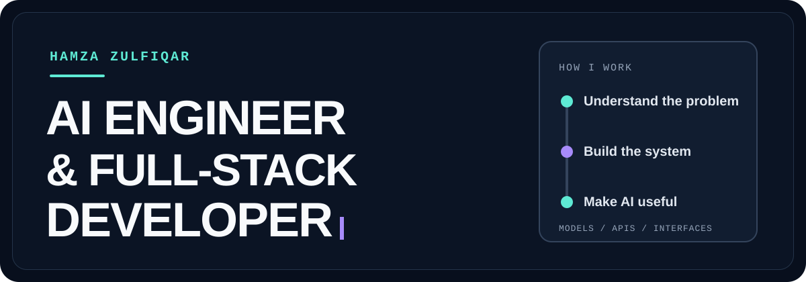

<p align="center">
  
</p>

<p align="center">
  <strong>AI engineer &amp; full-stack developer</strong> · Lahore, Pakistan
</p>

<p align="center">
  I build the whole product: the interface people use, the systems behind it, and the AI that makes it more useful.
</p>

<p align="center">
  <a href="#selected-work">Selected work</a> &nbsp;·&nbsp;
  <a href="#how-i-build">How I build</a> &nbsp;·&nbsp;
  <a href="mailto:hamzazulfiqar123123@gmail.com">Email me</a>
</p>

---

### A little about me

I'm Hamza, an AI research assistant at the University of Management and Technology and a full-stack developer who has shipped client software from architecture through deployment. I like projects where a useful model, a reliable API, and a clear interface have to work together.

My recent work spans an AI-assisted publishing platform, a multi-tenant CRM, a real estate operations system, an ecommerce storefront, and an explainable network intrusion detector. Different domains, same habit: make the complicated parts understandable to the person using the product.

### Selected work

<table cellpadding="16" cellspacing="0">
  <thead>
    <tr>
      <th width="31%" align="left">Project</th>
      <th width="69%" align="left">What I built</th>
    </tr>
  </thead>
  <tbody>
    <tr>
      <td width="31%" valign="top">
        <strong><a href="https://github.com/RHamzaZulfiqarJ/Mimico">Mimico ↗</a></strong><br />
        <sub>AI + SaaS</sub>
      </td>
      <td width="69%" valign="top">
        An AI-assisted social media workspace for drafting, rewriting, scheduling, and publishing across platforms. I built it as a solo developer with Next.js 16, React 19, TypeScript, Prisma, PostgreSQL, and Gemini 2.5 Flash.
      </td>
    </tr>
    <tr>
      <td width="31%" valign="top">
        <strong><a href="https://github.com/RHamzaZulfiqarJ/Mimico-CRM">Mimico CRM ↗</a></strong><br />
        <sub>Full-stack SaaS</sub>
      </td>
      <td width="69%" valign="top">
        A multi-tenant workspace for leads, clients, sales, finance, approvals, and team operations. Built with Next.js, TypeScript, Prisma, PostgreSQL, and Supabase, with organization-scoped access and audit trails.
      </td>
    </tr>
    <tr>
      <td width="31%" valign="top">
        <strong><a href="https://github.com/RHamzaZulfiqarJ/Marcable-Solutions">Marcable Solutions ↗</a></strong><br />
        <sub>Client work · MERN</sub>
      </td>
      <td width="69%" valign="top">
        A real estate CRM for leads, tasks, client interactions, and operational workflows. I worked across the React/Redux frontend, Express APIs, MongoDB data layer, and deployment.
      </td>
    </tr>
    <tr>
      <td width="31%" valign="top">
        <strong><a href="https://github.com/RHamzaZulfiqarJ/DineMarket">DineMarket ↗</a></strong><br />
        <sub>Ecommerce · full stack</sub>
      </td>
      <td width="69%" valign="top">
        A storefront with product browsing, cart, checkout, order handling, and an admin area. Built with Next.js, TypeScript, Prisma, and MongoDB.
      </td>
    </tr>
    <tr>
      <td width="31%" valign="top">
        <strong><a href="https://github.com/RHamzaZulfiqarJ/AI-Intrusion-Detector">SecureGen AI ↗</a></strong><br />
        <sub>Deep learning + RAG</sub>
      </td>
      <td width="69%" valign="top">
        A network intrusion detector using a PyTorch model trained on CICIDS2017, with retrieval-backed explanations through LangChain, FAISS, and Gemini. FastAPI and Next.js connect the model to an interactive dashboard; MLflow tracks experiments.
      </td>
    </tr>
  </tbody>
</table>

### How I build

```text
Interface    React · Next.js · TypeScript · Tailwind
Backend      Node.js · Express · FastAPI · REST APIs
Data         PostgreSQL · MongoDB · Prisma · Supabase
AI / ML      PyTorch · deep learning · RAG · Gemini
Delivery     Docker · Kubernetes · MLflow · Vercel
```

I care about the seams between those layers: clear data contracts, useful error states, access boundaries, and AI outputs that someone can inspect and act on.

### Beyond the codebase

I'm pursuing a BS in Artificial Intelligence at UMT. My research work covers computer vision and 6G digital twins, including studies on YOLO-based Siamese networks and ray-traced beam codebooks.

<p align="center">
  <a href="https://github.com/RHamzaZulfiqarJ?tab=repositories">Browse all repositories</a>
  &nbsp;·&nbsp;
  <a href="mailto:hamzazulfiqar123123@gmail.com">Get in touch</a>
</p>

<p align="center">
  
</p>
